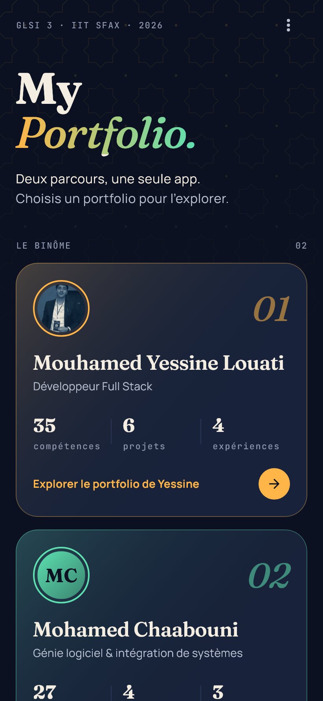
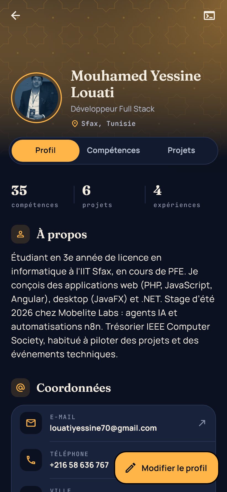
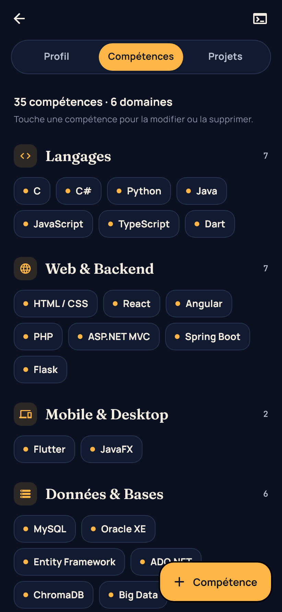
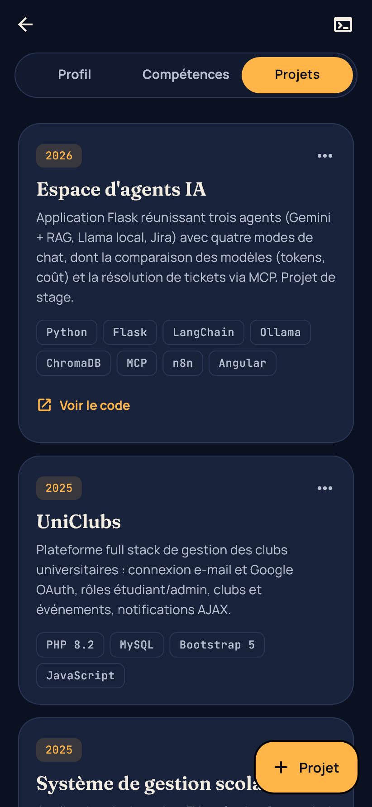
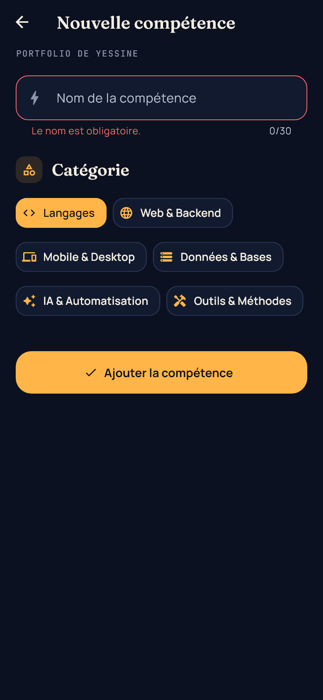
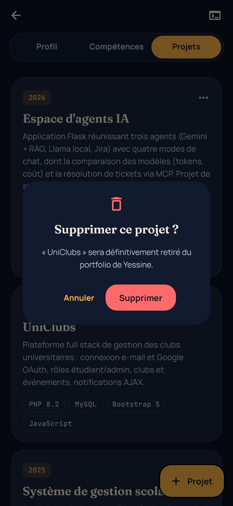
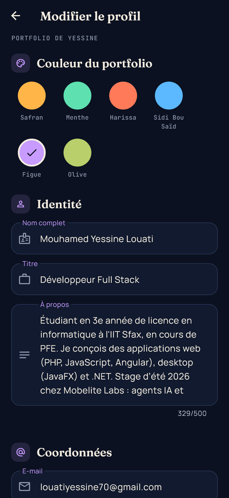
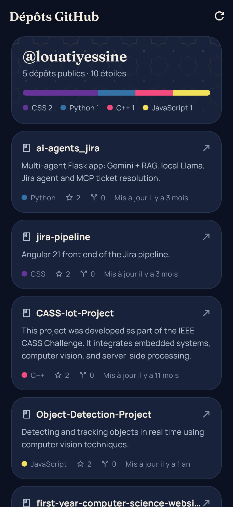

# MyPortfolio — deux parcours, une seule app

Application Flutter du DS de Développement mobile (GLSI 3, IIT Sfax, 2026).
Chaque membre du binôme a **son propre portfolio, indépendant**, dans la même application :
informations personnelles et académiques, parcours, compétences, projets et dépôts GitHub en direct.

**Binôme :** Mouhamed Yessine Louati · Mohamed Chaabouni

| Accueil | Profil | Compétences | Projets |
|:-:|:-:|:-:|:-:|
|  |  |  |  |

| Validation | Suppression | Couleur du portfolio | API GitHub |
|:-:|:-:|:-:|:-:|
|  |  |  |  |

---

## 1. Lancer le projet

```bash
git clone <url-du-depot>
cd <dossier-du-depot>
flutter pub get
flutter run            # sur l'émulateur Android ouvert
flutter run -d chrome  # ou dans le navigateur
```

Vérifications de qualité :

```bash
flutter analyze   # doit afficher « No issues found! »
flutter test      # tests unitaires et tests de widgets
```

## 2. Le barème, critère par critère

| Critère (points) | Ce qui le prouve dans l'app | Où dans le code |
|---|---|---|
| Structure et interface (2) | Accueil avec les 2 portfolios, thème cohérent, une couleur par étudiant | `screens/home_screen.dart`, `theme/` |
| Navigation (2) | Routes nommées, arguments typés, retour cohérent, animation Hero de l'avatar | `routes/app_routes.dart` |
| Informations du portfolio (2) | Profil (coordonnées, formation, parcours), compétences par catégorie, projets | `widgets/tabs/` |
| CRUD (3) | Ajout / modification / suppression des compétences et des projets, modification du profil, validation, confirmation, SnackBar | `screens/*_form_screen.dart`, `providers/portfolio_provider.dart` |
| Persistance (2) | Tout est sauvegardé en JSON dans `shared_preferences` et rechargé au démarrage | `services/storage_service.dart` |
| API REST (2) | Dépôts GitHub en direct : chargement, erreur + Réessayer, données | `services/github_api_service.dart`, `screens/github_repos_screen.dart` |
| Qualité du code (2) | Un fichier = une responsabilité, widgets réutilisables, commentaires, tests, 0 warning | tout `lib/`, `test/` |

## 3. Scénario de démonstration (5 minutes)

1. **Les deux portfolios** : sur l'accueil, montrer les deux cartes (couleur Safran pour Yessine, Menthe pour Mohamed).
2. **Navigation** : ouvrir un portfolio (l'avatar « vole » vers l'en-tête), passer d'un onglet à l'autre, revenir avec la flèche.
3. **Create** : onglet Compétences → bouton « Compétence » → envoyer à vide (erreur de validation) → saisir « Kotlin » → la pastille apparaît et une SnackBar confirme.
4. **Update** : onglet Projets → « ⋯ » → Modifier → changer la description → Enregistrer.
5. **Delete** : « ⋯ » → Supprimer → la boîte de dialogue demande confirmation.
6. **Profil** : bouton « Modifier le profil » → choisir une autre couleur → tout le formulaire change de couleur en direct.
7. **Persistance** : fermer complètement l'application puis la relancer : les modifications sont toujours là.
8. **Indépendance** : ouvrir l'autre portfolio : il n'a pas été touché.
9. **API REST** : icône terminal (en haut à droite) → dépôts GitHub chargés en direct. Activer le **mode avion** puis « Actualiser » → message d'erreur clair → désactiver le mode avion → « Réessayer ».
10. **Démo propre** : le menu « ⋮ » de l'accueil remet les données des CV (Réinitialiser).

## 4. Architecture

```text
lib/
  main.dart                 Point d'entrée : Provider au-dessus de MaterialApp
  data/seed_data.dart       Données initiales tirées des CV (premier lancement)
  models/                   Student, Education, Experience, Skill, Project, GithubRepo
  services/                 StorageService (persistance), GithubApiService (HTTP)
  providers/                PortfolioProvider : état + CRUD + notifyListeners()
  routes/                   AppRoutes (routes nommées), ItemFormArgs (arguments)
  screens/                  Pages complètes : accueil, portfolio, 3 formulaires, GitHub
  widgets/                  Composants réutilisables (cartes, champs, dialogues, onglets)
  theme/                    Palette, thème Material 3, couleur par étudiant
  utils/                    Validators, ouverture de liens, dates relatives
test/                       Tests des modèles, du provider, des validators, de l'API et du CRUD
```

**Rôles :** un *Model* décrit les données ; un *Service* les lit/écrit (stockage, API) ;
le *Provider* garde l'état et prévient l'interface ; un *Screen* est une page ; un *Widget* est un morceau d'interface réutilisable.

### Flux d'un ajout (à savoir expliquer)

```text
Bouton « Projet »  ->  Navigator.pushNamed(AppRoutes.projectForm, arguments: ItemFormArgs)
Formulaire         ->  _formKey.currentState!.validate()   (validators)
                   ->  PortfolioProvider.addProject(studentId, project)
Provider           ->  _students = [...]                    (nouvelle liste)
                   ->  StorageService.saveStudents()        (JSON -> shared_preferences)
                   ->  notifyListeners()                    (les écrans « watch » se reconstruisent)
Formulaire         ->  SnackBar + Navigator.pop()           (retour au portfolio)
```

Au redémarrage : `PortfolioProvider.load()` → `StorageService.loadStudents()` → `jsonDecode` + `fromJson`.
Si le stockage est vide (premier lancement), les données des CV sont enregistrées.

## 5. Choix techniques

| Besoin | Choix | Pourquoi |
|---|---|---|
| État | `provider` (ChangeNotifier) | Simple, officiel, `notifyListeners()` facile à expliquer |
| Persistance | `shared_preferences` + JSON | Léger et suffisant pour deux portfolios |
| API | `http` + API GitHub | Gratuite, sans clé, cohérente avec un portfolio |
| Navigation | `MaterialApp(routes: ...)` + `pushNamed(arguments:)` | Routes nommées centralisées |
| Liens | `url_launcher` | Ouvrir e-mail, téléphone, LinkedIn, GitHub |

Gestion des erreurs de l'API (`GithubApiService`) : pas de réseau (`ClientException`), délai dépassé (`timeout` de 10 s),
compte inconnu (404), limite de requêtes (403/429), JSON inattendu. Chaque cas donne un message en français.

## 6. Design « Nuit de Sfax »

Fond bleu nuit, texte couleur parchemin, motif d'étoiles à huit branches inspiré des zelliges (dessiné avec un `CustomPainter`),
titres en **Fraunces**, texte en **Manrope**, étiquettes techniques en **JetBrains Mono** (polices embarquées, sous licence OFL).

| Couleur | Hex | Rôle |
|---|---|---|
| Ink | `#0B1120` | Fond |
| Dusk | `#18233B` | Cartes |
| Parchment | `#F4EDE1` | Texte principal |
| Safran | `#FFB547` | Accent de Yessine |
| Menthe | `#5EE0B0` | Accent de Mohamed |
| Harissa, Sidi Bou Saïd, Figue, Olive | | Autres accents au choix dans le profil |

Contrastes vérifiés (WCAG AA) : le texte le plus discret (`#8C95AB`) atteint 6,3:1 sur le fond et 5,2:1 sur les cartes.

## 7. Questions probables du professeur

- **StatelessWidget ou StatefulWidget ?** `PortfolioScreen` est Stateful (onglet actif, `TabController`) ; `ProjectCard` est Stateless (affiche ce qu'on lui donne).
- **Pourquoi `context.watch` et `context.read` ?** `watch` dans `build` pour se reconstruire quand les données changent ; `read` dans les actions (boutons) pour appeler une méthode sans s'abonner.
- **Pourquoi le `Future` de l'API n'est pas créé dans `build` ?** Sinon chaque reconstruction relancerait la requête. Il est créé dans `didChangeDependencies` et recréé par « Réessayer ».
- **Pourquoi `setState(() { ... })` avec des accolades dans `_reload` ?** Avec `=>`, la fonction renverrait le `Future` affecté, ce que Flutter interdit.
- **Comment les deux portfolios restent indépendants ?** Chaque `Student` possède ses listes ; chaque méthode CRUD reçoit un `studentId` et ne modifie que cet étudiant.
- **À quoi sert `copyWith` ?** Créer une copie modifiée d'un objet immuable au lieu de le modifier directement.
- **À quoi sert `dispose()` ?** Libérer les `TextEditingController` et le `TabController` pour éviter les fuites de mémoire.

## 8. Travailler à deux

```bash
git pull                      # récupérer le travail de l'autre avant de commencer
git checkout -b ma-fonction   # travailler sur une branche
git add . && git commit -m "Description claire"
git push -u origin ma-fonction
```
